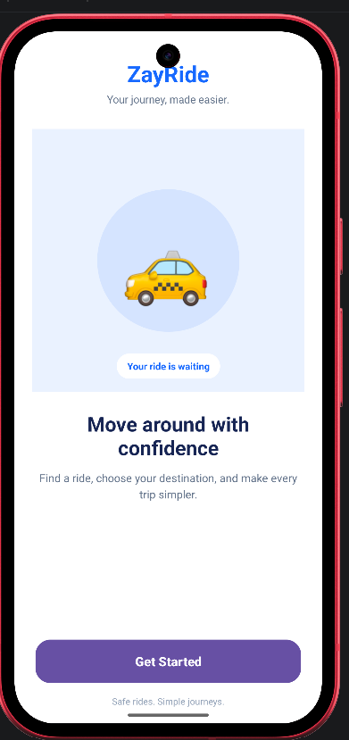
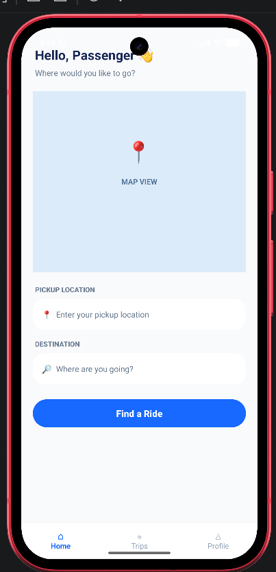
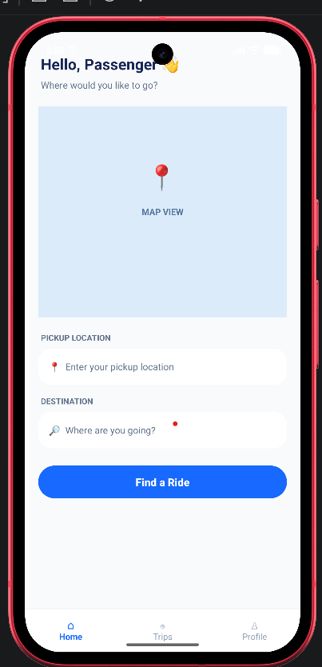

# ZayRide Passenger — UI/UX Redesign

An Android UI/UX redesign concept for **ZayRide**, developed as part of the SENG4061 UI/UX assignment at Debre Berhan University.

The project explores a clearer passenger ride-booking experience through an Android prototype and supporting design documentation.

## Project overview

The prototype focuses on three redesigned screens:

1. **Welcome screen** — introduces the application and provides a starting action.
2. **Home / find a ride screen** — presents pickup and destination information.
3. **Choose your ride screen** — presents ride options and an estimated fare before confirmation.

## Redesigned screen previews

These images are the redesigned prototype screens included in this repository.

| Welcome screen | Home screen |
|---|---|
|  |  |

**Ride selection screen**



[View all redesigned screenshots](https://github.com/kura458/ZayRide-UX-Redesign/tree/main/screenshots)

## Original reference screenshots

The original reference screenshots are stored separately in `ScreenShuts/`. They are reference materials, not the redesigned prototype screens.

## Objectives

- Improve visual hierarchy and readability.
- Organize important ride-booking information.
- Use consistent colors, typography, spacing, and buttons.
- Apply accessibility principles to interactive elements.
- Build Android interface layouts using XML.

## Technologies and tools

- Android Studio
- Java
- XML layouts
- Android drawable resources
- Gradle
- Git and GitHub

## Project structure

```text
ZayRide-UX-Redesign/
├── android-design/
│   └── app/
│       └── src/main/
│           ├── java/com/kura/zayrideredesign/
│           └── res/
├── screenshots/             # Redesigned prototype screenshots
├── ScreenShuts/              # Original reference screenshots
├── CRITIQUE.md
├── PROPOSAL.md
├── RESOURCES.md
└── README.md
```

## Run the Android prototype

1. Clone this repository.
2. Open the `android-design` folder in Android Studio.
3. Allow Gradle to sync.
4. Start an Android emulator.
5. Run the app.

Package name: `com.kura.zayrideredesign`.

## Scope and limitations

This is an academic UI prototype. It demonstrates interface design and basic screen navigation; it does not provide production ride booking, live GPS tracking, driver matching, payment processing, or backend services.

The original Passenger application was not installed and tested directly. Historical screenshots are used as references and do not establish that the original app is currently operational.

## Documentation

- [CRITIQUE.md](CRITIQUE.md) — UI/UX evaluation.
- [PROPOSAL.md](PROPOSAL.md) — redesign proposal and scope.
- [RESOURCES.md](RESOURCES.md) — references and tools used.

## Author

**Kura Lemma**  
Software Engineering Student  
Debre Berhan University

---
*An academic project applying user-centered design principles to an Ethiopian transportation experience.*
